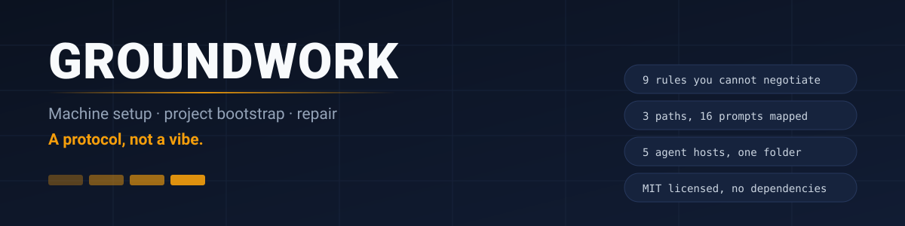
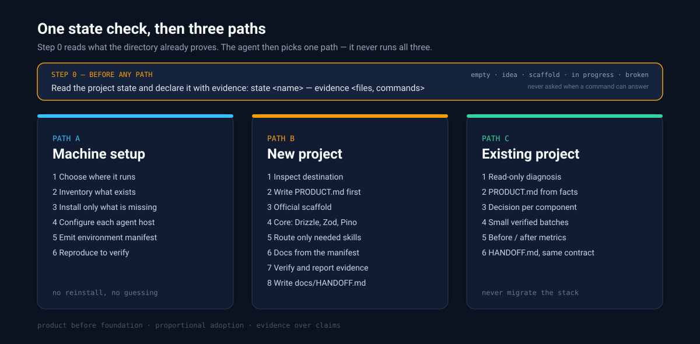

# Groundwork

[](LICENSE)
[](SKILL.md)
[](#compatibility)
[](SKILL.md)



> **Groundwork turns "set up this machine / start this project / fix this repo" into a protocol an AI agent can follow** — explicit rules, verifiable steps, and a map of which prompt or tool to use when.

An agent with a terminal can install anything. The hard part is knowing what *not* to install, what must be decided before code exists, and when a change stops being yours to make.

Groundwork is a skill — a folder of instructions an agent loads on demand — that encodes that discipline. It is a distilled operational layer over [vibe-coding-toolkit](https://github.com/soumatheusgomes/vibe-coding-toolkit) (MIT), reduced to what fits in a context window.

---

## Why this exists

Most agent failures on project setup are not capability failures. They are ordering failures and scope failures.

| What usually happens | What it costs |
|---|---|
| Scaffolding before the product is described | a stack the product does not need |
| Installing every recommended tool | hours lost, dependencies nobody uses |
| "While I'm here" migrations | a working project broken by a well-meaning refactor |
| `--force` to get past a peer conflict | a dependency tree that fails later, silently |
| Reporting success without running the build | a broken `main` and a false claim |
| Documenting with placeholders | documentation that lies from day one |

Groundwork is a fixed set of answers to those six situations. It does not add capability; it removes improvisation.

---

## Three paths, one protocol



The agent chooses the path from the request. It never runs all three.

| Path | Trigger | Outcome |
|---|---|---|
| **A — Machine setup** | new machine, missing toolchain | inventory, install only what is missing, client configuration, reproducible environment manifest |
| **B — New project** | "start a project from zero" | `PRODUCT.md` first, official scaffold, core dependencies, routed skills, documentation, verified build |
| **C — Existing project** | "fix / configure / take over this repo" | read-only diagnosis, product reconstructed from facts, per-component decision, small verified batches, before/after metrics |

Path C is the one that matters most in practice: most real work happens on a codebase that already exists and already works.

---

## The nine rules

These are the part of the skill that does not bend. Each one exists to prevent a specific, observed failure.

| # | Rule | Prevents |
|---|---|---|
| 1 | **Product before foundation** — `PRODUCT.md` before any stack choice | building the wrong thing efficiently |
| 2 | **Proportional adoption** — every component gets an explicit decision: adopt, equivalent already present, or rejected with a reason | tool hoarding |
| 3 | **Never migrate an existing stack as a side effect** | "while I'm here" rewrites |
| 4 | **One toolkit revision per project** | mixing files from different versions |
| 5 | **No secrets in plaintext** — `.env.local` ignored, `.env.example` versioned and clean | credentials in git history |
| 6 | **No `--force` / `--legacy-peer-deps` to hide conflicts** | dependency trees that break later |
| 7 | **Migrations only on an authorized destination**, never on build, import, or request | silent schema changes in production |
| 8 | **No push, deploy, or publish without an explicit request** | unrequested public actions |
| 9 | **Verify before asserting** — check stable channels instead of assuming `@rc` / `@canary` / `latest` | confident wrong claims about versions |

---

## Install

A skill is a directory. Copy it where your agent looks for skills.

| Host | Path | Notes |
|---|---|---|
| **Hermes** | `<hermes-home>/skills/groundwork` | or install from the registry, below |
| **Claude Code** | `~/.claude/skills/groundwork` | native `SKILL.md` support |
| **Codex** | `~/.codex/skills/groundwork` | reads `SKILL.md` with frontmatter |
| **OpenCode** | `~/.config/opencode/skills/groundwork` | same format |
| **Codebuff / Freebuff** | `~/.agents/skills/groundwork` | also reads `~/.claude/skills`; `.agents/` wins |

```bash
git clone https://github.com/nemesis1978/groundwork.git
cp -r groundwork ~/.claude/skills/
```

With Hermes, directly from the registry:

```bash
hermes skills install nemesis1978/groundwork
```

### One-liner per host

| Host | Command |
|---|---|
| **Hermes** | `hermes skills install nemesis1978/groundwork` |
| **Claude Code** | `git clone https://github.com/nemesis1978/groundwork.git ~/.claude/skills/groundwork` |
| **Codex** | `git clone https://github.com/nemesis1978/groundwork.git ~/.codex/skills/groundwork` |
| **OpenCode** | `git clone https://github.com/nemesis1978/groundwork.git ~/.config/opencode/skills/groundwork` |
| **Codebuff / Freebuff** | `git clone https://github.com/nemesis1978/groundwork.git ~/.agents/skills/groundwork` |
| **skills.sh CLI** | `npx skills add nemesis1978/groundwork` |

### Let an agent install it for you

Paste this into any agent with shell access — it resolves its own skills directory, so you do not need to know the path:

```text
Install the "groundwork" skill from https://github.com/nemesis1978/groundwork
into the skills directory your runtime reads (~/.claude/skills, ~/.agents/skills,
~/.codex/skills, or ~/.config/opencode/skills), as a folder named "groundwork".
Verify that SKILL.md is readable, that its frontmatter name is "groundwork",
and that the four files in references/ are present. Report the resolved absolute
path and the checksum of SKILL.md. Do not modify any other skill or config.
```

To load it in the current session immediately, append:

```text
Then read SKILL.md and confirm step 0 (read the project state) and the three
paths (machine setup, new project, existing project) are present.
```

For several hosts at once, edit `TARGETS` in [`scripts/sync-skill.sh`](scripts/sync-skill.sh) and run it. Restart the agent session afterwards — hosts read the skills directory at startup.

### Prerequisite (optional but recommended)

The skill references the upstream toolkit as `<TOOLKIT>`:

```bash
git clone https://github.com/soumatheusgomes/vibe-coding-toolkit.git
```

Without it the skill still works: the reference files carry the essential commands, while `.template` files are recreated from the project.

---

## How an agent uses it

You do not invoke it. The `description` field is what makes an agent load it when the request matches.

**You say:**

> "I want to start a small internal tool for tracking supplier orders. Set it up properly."

**What happens with Groundwork:**

0. **Before anything:** it reads the directory — `ls -a`, `git status --short`, presence of `PRODUCT.md` / `docs/SPEC.md` / `docs/BUILD_PHASES.md` / `docs/HANDOFF.md` — and declares one state with its evidence: *empty*, *idea*, *scaffold*, *in progress*, or *broken*. It does not ask what a command can prove.
1. It asks for the product facts it cannot infer — audience, flows, MVP boundary — and writes `PRODUCT.md`. Assumptions are labeled; unknown external information stays open instead of being invented.
2. It checks current stable versions and scaffold flags instead of copying an old command.
3. It generates the official scaffold, then adds only the core the product needs.
4. It installs only the skills the project will actually use.
5. It generates the documentation manifest, configures lint and commands, and **runs the build**.
6. It reports what passed, what did not, and what is still open.
7. It writes `docs/HANDOFF.md` — verified state, open work in order, traps already paid for — so the next session resumes instead of restarting.

**What it refuses:**

- Migrating your ORM "because Drizzle is the default".
- Silencing a peer-dependency conflict with `--force`.
- Pushing or deploying without you asking.
- Declaring done without a green build.

---

## What's inside

```
SKILL.md                         step 0, triggers, 9 rules, 3 paths, default stack, anti-patterns
references/bootstrap-nextjs.md   8 steps with real commands and flags
references/existing-project.md   diagnose → plan → batches → before/after metrics
references/handoff.md            the handoff contract shared with phased-build-orchestrator
references/prompts.md            the 16 upstream prompts, mapped to "when / what it produces"
references/tools-map.md          23 external tools → what exists in a given host, what to substitute
scripts/sync-skill.sh            copy the skill into several agent hosts
assets/                          the diagrams in this README
```

Approximate size of the instruction layer: **1 400 lines**. A `SKILL.md` of ~130 lines loads first; references are read only when the chosen path requires them.

---

## Default stack (a decision reference, not a dogma)

Deviations are allowed — they must be written down and justified in `PRODUCT.md` and `docs/architecture.md`.

| Area | Default | Limit |
|---|---|---|
| Application | stable Next.js, App Router, strict TypeScript, Tailwind, ESLint, `src/`, `@/*` | preserve existing app and package manager |
| Persistence | Drizzle ORM + PostgreSQL (`pg` driver) | a product with no persistence omits it, with a stated reason |
| Validation | Zod on env, inputs, external responses | types do not validate at runtime |
| Server code | `server-only` for env, logger, db client | secrets never in `NEXT_PUBLIC_*` |
| Logging | Pino, structured fields, redaction of known secrets | redaction does not cover secrets written into messages |
| Tests | Vitest on server logic, runnable without credentials | DOM/E2E only when a flow needs them |
| Quality | Next/TS presets, typed async checks, 350-line file limit | ORM guards do not replace review |

---

## Design principles

1. **Evidence over claims.** A step is done when a command returned a result, not when the agent says it is.
2. **Reversibility.** Prefer the change you can undo, especially on someone else's codebase.
3. **Proportionality.** The size of the process follows the size of the request.
4. **Explicit unknowns.** "I don't know" is a valid, recorded state; an invented fact is not.

---

## What this is not

- **Not a fork.** Upstream templates and full prompts stay upstream; this repository holds a distillation plus routing.
- **Not a project generator.** It does not scaffold anything by itself — it tells the agent how to do it correctly.
- **Not a replacement** for code review, threat modeling, or a security audit skill. It points to them when they apply.
- **Not a prompt pack.** It is a decision procedure with named failure modes.

---

## Language

All instructions are in **English**: the README, `SKILL.md`, and the four reference files. Commands, paths, and diagrams are language-neutral, and the short English `description` is what lets a host match the skill against a request.

Translations are welcome as pull requests — keep code blocks, file paths, and the rule numbering identical so the versions stay comparable line by line.

---

## Compatibility

Any host that reads a `SKILL.md` with `name` and `description` frontmatter can use this. The format constraints are strict and simple:

- `name` lowercase, hyphenated, **identical to the directory name**;
- `description` short — it is what the host matches against the user's request;
- supporting files in `references/`, referenced with relative paths.

Tested on Hermes, Claude Code, Codex, OpenCode and Codebuff/Freebuff — as the same directory copied with identical checksums, not as five separate ports.

---

## Updating

```bash
git pull
# then re-copy into each host, or run scripts/sync-skill.sh
```

Keep local edits in a branch. If you change the rules, change `SKILL.md` in one place and re-sync — divergence between hosts is the main failure mode of a multi-agent setup.

Version history: [CHANGELOG.md](CHANGELOG.md).

---

## Contributing

Corrections and complete translations are welcome as pull requests. Changes to the nine rules, the three paths, or the default stack need an issue first — the reasoning is in [CONTRIBUTING.md](CONTRIBUTING.md).

Every pull request must pass the format contract:

```bash
bash scripts/validate-skill.sh
```

It checks the things that break silently otherwise: `name` matching the directory, references that exist and are not orphaned, absolute paths, the rule count, `SKILL.md` length, obvious secrets.

## Attribution

Derived from [vibe-coding-toolkit](https://github.com/soumatheusgomes/vibe-coding-toolkit) by **Matheus Gomes**, MIT licensed. This repository contains no upstream code: it is a distillation with references, plus original rules, routing, and documentation.

If you find this useful, star the upstream project — that is where the underlying work lives.

## License

[MIT](LICENSE). Original work © 2026 Matheus Gomes; derivative work © 2026 Egix.
